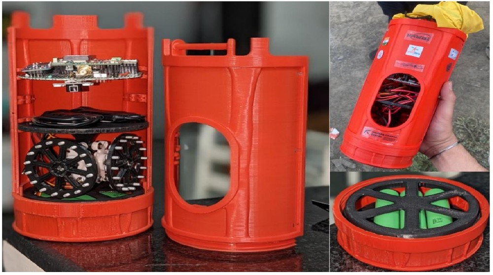
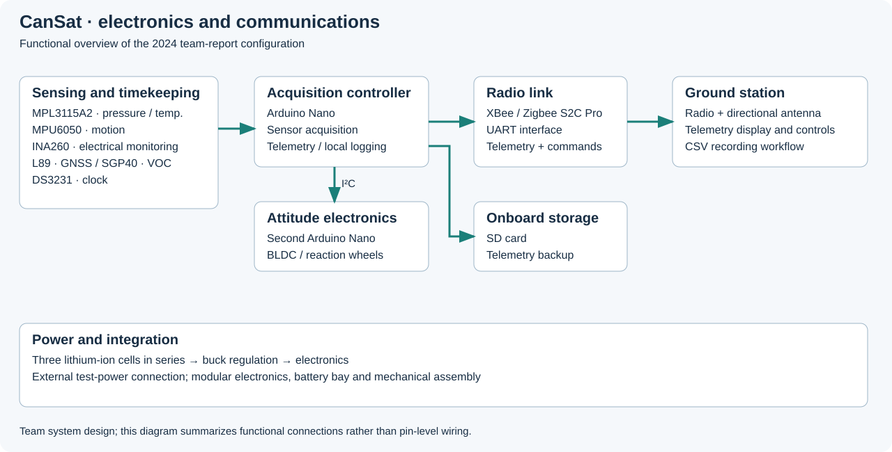
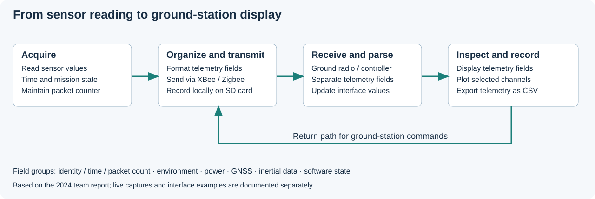
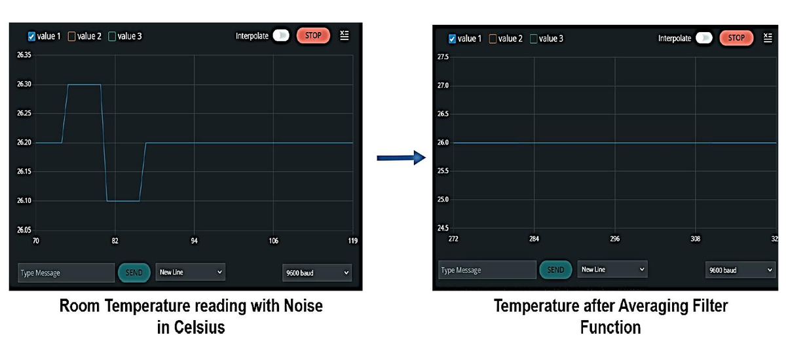
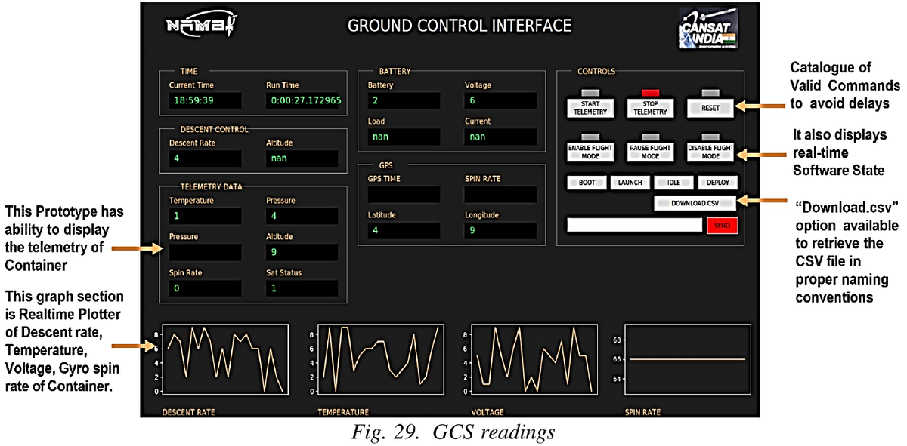
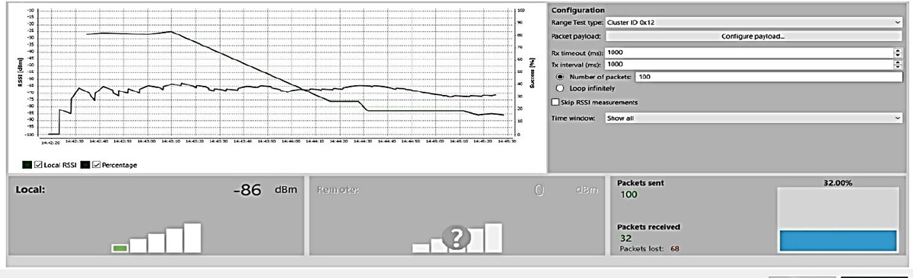
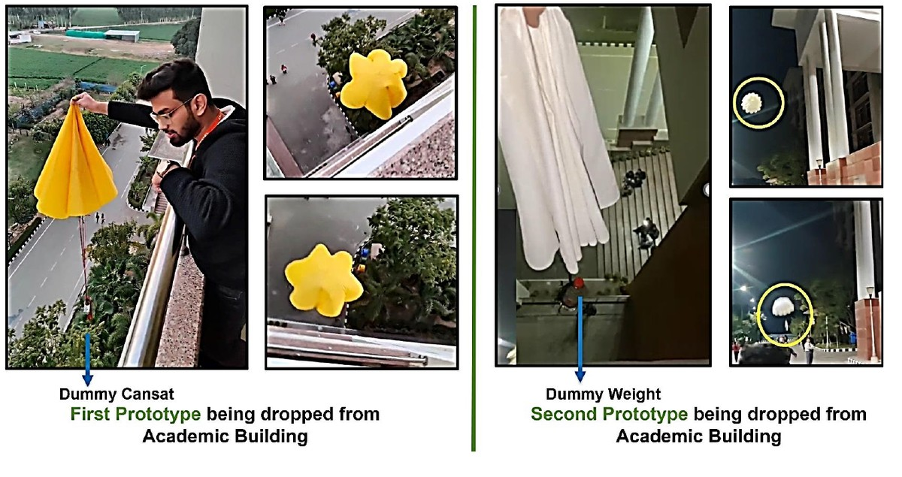

<h1 align="center">CanSat — Atmospheric Data Acquisition</h1>

<strong>Electronics, embedded sensing and wireless telemetry in a team-built payload</strong>

My team and I developed a CanSat to bring atmospheric sensing, onboard processing,
wireless telemetry and a recovery mechanism into a compact payload. The challenge
was integration: the electronics had to fit the mechanical assembly, share a power
source and deliver useful readings to a ground station while the mission progressed.

## My role

The team's mission plan listed me as Mission Control Officer. My primary
engineering work was in **sensor integration, embedded data acquisition and wireless
telemetry**, including the Zigbee link and ground-station data path. The CDR
identified me as Housekeeping Subsystem Officer. I coauthored the later project
report; the structure, parachutes and recovery mechanisms were wider team efforts.

## How the system fits together

The later report describes two Arduino Nano controllers: one for sensor acquisition
and telemetry, and a second for the reaction-wheel electronics. That account
assigns distinct data-handling and attitude-control roles and describes local
SD-card recording alongside the ground-station radio link.
Both diagrams summarize the later report's functional description; they are not
independent confirmation of every connection on the final assembled hardware.

| Subsystem | Components documented in the 2024 report | Role |
|---|---|---|
| Processing | Two Arduino Nano controllers | Acquisition/telemetry and reaction-wheel control |
| Environment | MPL3115A2, SGP40 | Pressure, temperature, barometric altitude and VOC-index channels |
| Motion and position | MPU6050, L89 GNSS | Acceleration, angular rate and position data |
| Electrical monitoring and timing | INA260, DS3231 | Battery-related measurements and timekeeping |
| Communications | XBee / Zigbee S2C Pro, directional ground antenna | Telemetry downlink and command return path |
| Power | Three lithium-ion cells in series, buck regulation, external test-power input | Supply distribution and bench integration |

The earlier design reviews also considered Teensy and Vega controllers. The
[engineering notes](docs/engineering-notes.md) explain how those documents differ
from the later prototype report.

## From a sensor reading to the ground station

The data-handling design grouped sensor values with a timestamp, packet count and
mission state. The radio carried those fields to the ground station, where an
interface displayed selected channels and provided a CSV-export workflow. Local
storage offered another route to retrieving telemetry after a test.

The flight-software design used six mission states: **boot, idle, launched,
descending, parachute deployed and landed**. The report also describes averaging
sensor readings before presenting them. These were practical embedded-system
problems: organizing acquisition, tracking state and making the output inspectable.

## Integration and testing

<table>
<tr>
<td width="50%"> <strong>Sensor bring-up</strong> The report's temperature captures show acquisition and an averaging example. They cover different time windows.</td>
<td width="50%"> <strong>Ground-station interface</strong> A prototype display for sensor channels, mission state, commands and recorded data.</td>
</tr>
</table>

The hardware photographs show the assembled electronics and modular enclosure.
The documentation also records radio-link testing and parachute experiments with
dummy payloads. Together, these show the work involved in moving from subsystem
choices to an integrated prototype.

## What the recorded results show

One XCTU capture in the team report shows **32 packets received from 100 sent**,
with **68 lost**. It is a useful troubleshooting record, rather than a successful
range demonstration: the image has no corresponding distance log or repeat trials.

The sensor captures and interface screens document acquisition and presentation,
not calibrated sensor accuracy or a measured filtering improvement. The main lesson
I took from the project was that a working sensor, a radio connection and a readable
interface must be tested together; selecting components alone does not complete
the system.

## Parachute prototype work

These photographs show the team's parachute prototypes and dummy-payload tests.
They preserve the distinction between testing a descent mechanism and flying the
complete instrumented CanSat.

## Documentation and acknowledgments

This page draws on the NAMBI team's 2022–23 design reviews and a 2024 project report
coauthored by Mohit, Himanshu, Yashika Yadav and Bhuvan Lakhera. Hardware and recovery
work were team efforts. The selected photographs and captures are reproduced with
permission; new diagrams summarize the documented system.

The report contains design budgets and estimated descent performance, but the
available project folder has no raw flight or telemetry files from which to verify
endurance, range or descent-rate statistics. Full firmware and CAD are not included.
[Engineering notes and figure context](docs/engineering-notes.md) ·
[Media attribution and rights](MEDIA_RIGHTS.md).

For my later work in robot learning, see [Go2 RL Locomotion](https://github.com/Bhuvanlakhera23/go2-rl-locomotion).
